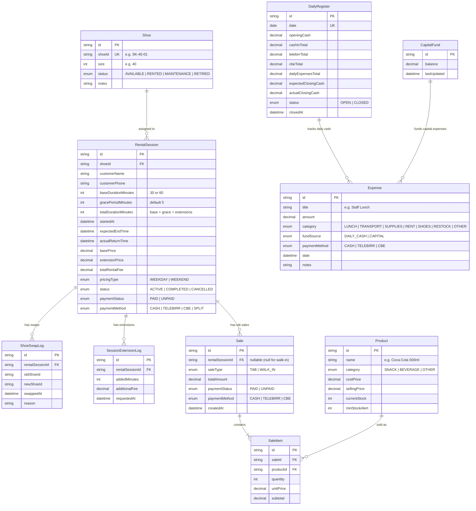

# Velox — Technical Architecture & Implementation Plan

This document outlines the technical stack, database schema, system architecture, and phased development roadmap for the **Velox Skate Rink & Cafe Management System**.

---

## 1. Recommended Technology Stack

| Layer | Recommended Choice | Justification |
| :--- | :--- | :--- |
| **Framework** | **Next.js 15 (App Router)** | Full-stack TypeScript in a single codebase. Server actions for low-latency mutations; SSR for fast dashboard initial loads. |
| **Language** | **TypeScript** | End-to-end type safety across rentals, pricing, inventory calculations, and financial ledgers. |
| **UI & Styling** | **Tailwind CSS + shadcn/ui** | Clean, high-density POS interface. Accessible, modular components with dark/light mode for rink environments. |
| **Icons** | **Lucide React** | Feather-light icons for shoes, timers, drinks, snacks, payment badges. |
| **Database & ORM** | **Prisma ORM with SQLite or PostgreSQL** | - **SQLite:** Zero-config, runs anywhere offline on the counter PC with zero maintenance.<br/>- **PostgreSQL:** Easy swap if multi-device cloud deployment is preferred. |
| **Client State / Timers** | **Zustand + React Hooks** | Real-time interval hook synchronized against server timestamps (`expectedEndTime`) so browser restarts don't lose time. |
| **Sound / Notifications** | **Web Audio API / Howler.js** | Subtle audio chime when a skater's timer enters the final 2 minutes or expires. |

---

## 2. Relational Database Schema Design (Prisma / SQL)



---

## 3. Core Engine Logics

### 3.1 Session Time Calculation Algorithm
```typescript
// Calculation formula
const isWeekend = (date: Date) => [0, 6].includes(date.getDay()); // 0 = Sun, 6 = Sat

function calculateSessionParameters(duration: 30 | 60, startTime = new Date()) {
  const weekend = isWeekend(startTime);
  const basePrice = duration === 30 ? (weekend ? 200 : 150) : (weekend ? 300 : 250);
  const gracePeriodMinutes = 5;
  const totalMinutes = duration + gracePeriodMinutes;
  
  const expectedEndTime = new Date(startTime.getTime() + totalMinutes * 60 * 1000);

  return {
    pricingType: weekend ? 'WEEKEND' : 'WEEKDAY',
    basePrice,
    gracePeriodMinutes,
    totalMinutes,
    expectedEndTime
  };
}
```

### 3.2 Real-Time Timer & Countdown Logic
- Timers run via `requestAnimationFrame` or `1s setInterval` measuring `expectedEndTime.getTime() - Date.now()`.
- Status categories:
  - `TimeRemaining > 5 min` ➔ **🟢 Active**
  - `0 <= TimeRemaining <= 5 min` ➔ **🟡 Due Soon**
  - `TimeRemaining < 0` ➔ **🔴 Overdue by X mins**

---

## 4. Phased Implementation Roadmap

### **Phase 1: Project Setup & Core Foundation**
- [ ] Initialize Next.js 15 with TypeScript, Tailwind CSS, and shadcn/ui.
- [ ] Setup Prisma ORM with SQLite database (easy setup, single file database for local stability).
- [ ] Implement database seed script with sample shoes (Sizes 36–45, multiple IDs per size) and standard snacks/drinks.
- [ ] Setup global layouts, navigation bar, and dark/light rink counter themes.

### **Phase 2: Skate Inventory & Live Rental Timer Board**
- [ ] **Shoe Inventory Management:** CRUD for shoes (Size, Shoe ID, Status).
- [ ] **Start Rental Modal:** Shoe size filter ➔ available Shoe ID selector ➔ duration (30/60m) ➔ auto weekday/weekend pricing ➔ auto +5 min buffer.
- [ ] **Live Timer Board:**
  - Real-time countdown cards sorted by earliest finish time.
  - Color-coded badges (`Active`, `Due Soon`, `Overdue`).
  - Search/filter by Shoe ID.
- [ ] **In-Session Actions:**
  - Mid-session Shoe Swap (maintains timer, switches shoe IDs).
  - Time Extension (+30 or +60 mins with price recalculation).
  - Return confirmation & checkout modal.

### **Phase 3: Snack & Beverage Concession (POS)**
- [ ] Product & Stock management (add/edit items, cost price, sell price, stock levels, low-stock threshold).
- [ ] **POS Screen:**
  - Fast-click item grid.
  - "Attach to Skater Tab" (search by active Shoe ID).
  - "Walk-in Direct Sale" (instant checkout).
- [ ] Automatic stock reduction on sale.

### **Phase 4: Multi-Channel Payments & Two-Tier Accounting**
- [ ] Payment settlement dialog: Cash, Telebirr, CBE (with support for split payments).
- [ ] **Two-Tier Expense Tracker:**
  - Daily Petty Expenses (Staff lunch, transport) ➔ Deducted from Daily Cash Register.
  - Capital Expenses (Shoe purchases, rent, bulk restock) ➔ Deducted from General Capital Fund.
- [ ] General Capital Ledger (deposits, CapEx withdrawals, balance).

### **Phase 5: Daily Closing & EOD Audit Reports**
- [ ] Daily Register opening and closing workflow.
- [ ] End-of-Day (EOD) audit summary:
  - Total rentals, total snack sales, gross revenue.
  - Cash drawer reconciliation (Expected cash vs Actual counted cash).
  - Telebirr & CBE digital transaction totals.
  - Net daily profit report.
- [ ] Exportable / Printable daily receipt summary.

### **Phase 6: Audio Alerts, Refinements & Testing**
- [ ] Audio notification when session is Due Soon (< 5 mins) or Overdue.
- [ ] Keyboard shortcuts for rapid counter operations (e.g. `F2` New Rental, `/` search shoe).
- [ ] Verification tests for all business rules.

