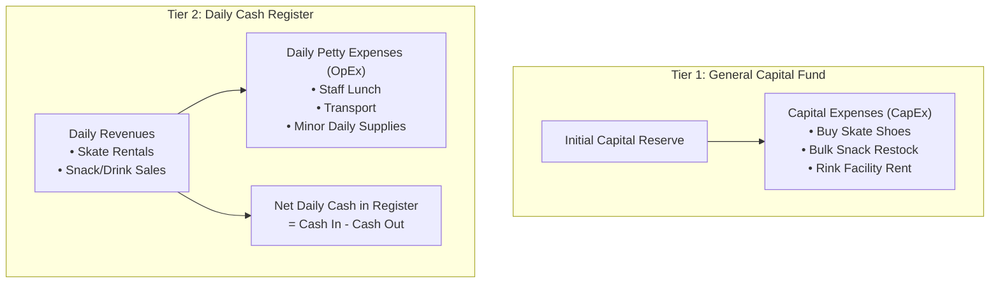
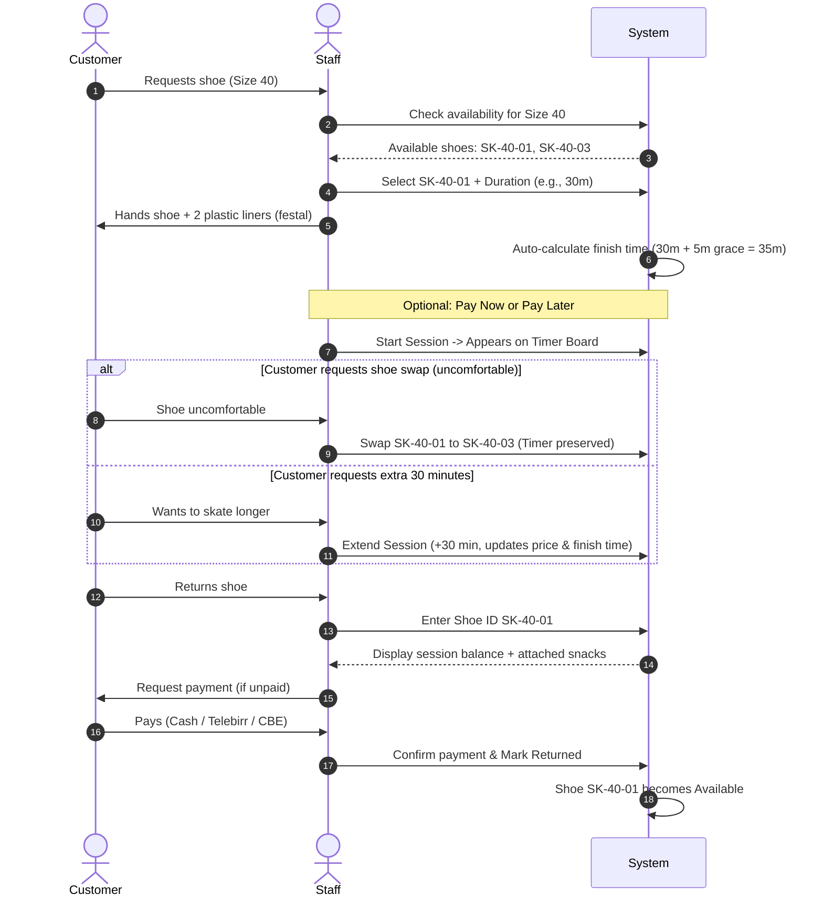

# Skate Rink & Cafe Internal Management System (Velox)
## Comprehensive System Requirements Specification

**Document Version:** 1.0  
**Context:** Internal Operations & POS System for Skate Rink, Snack Bar & Financial Accounting  
**Currency:** Ethiopian Birr (ETB)  
**Payment Channels:** Cash, Telebirr, CBE (Commercial Bank of Ethiopia)  

---

## 1. Executive Summary

The client operates a commercial roller/ice skating rink that offers:
1. **Skate Rentals:** Timed shoe rentals with specific operational rules (size matching, unique equipment tracking, automatic prep grace periods, weekday/weekend pricing, and in-flight time extensions).
2. **Snack & Beverage Concession:** Over-the-counter sales either attached to an active skater's tab or sold directly to walk-in spectators.
3. **Cash & Capital Accounting:** Strict separation between **General Capital** (purchasing skate assets, stock replenishment, facility rent) and **Daily Cash Register** (daily revenue intake minus day-to-day petty cash expenses like staff lunch and transport).

The goal is to eliminate paper logbooks, prevent revenue leakage, track equipment status, automate rental countdowns, and provide clear end-of-day financial reconciliation across cash, Telebirr, and CBE.

---

## 2. Terminology & Operational Context

| Term | Operational Definition |
| :--- | :--- |
| **Shoe Size** | Standard commercial shoe size (e.g., 38, 39, 40, 41). Non-unique (multiple shoes share the same size). |
| **Shoe ID / Asset ID** | Unique physical barcode/tag identifier permanently assigned to each individual shoe (e.g., `SK-40-01`, `SK-40-02`). Used for inventory and tracking returns. |
| **Festal / Lastics** | Ethiopian local term for disposable plastic foot covers / liners given to customers with rental shoes for hygiene before putting skates on. |
| **Prep Grace Period** | An automatic default 5-minute buffer added to every session timer (e.g., a 30-min booking counts down from 35 mins) to account for lacing shoes and entering the rink. |
| **Skater Tab** | An open session bill where skate time and any snacks/drinks consumed during the session can be accumulated and settled upon shoe return. |
| **Walk-in Sale** | Standalone POS transaction for non-skating visitors buying snacks or drinks. |
| **Daily Cash Drawer** | Physical cash collected today from rentals and concessions, from which daily petty expenses are deducted. |
| **General Capital** | The business's main capital reserve used for capital expenditures (CapEx) like purchasing shoes, inventory batches, and paying rent. |

---

## 3. Core Functional Requirements

### Module 1: Skate Shoe Inventory & Asset Management

#### 1.1 Dual Identifier System
- Every shoe has:
  - **Size:** e.g., `40`
  - **Unique Shoe ID:** e.g., `SK-40-01`
- The system must prevent duplicate Shoe IDs while allowing multiple shoes of the same size.
- **Statuses:** `Available`, `Rented (Active Session)`, `Under Maintenance`, `Retired/Damaged`.

#### 1.2 Availability Check & Assignment
- Operators quickly filter by requested shoe size to see available units.
- If all shoes of a requested size are rented, the system indicates "Out of Stock / Waiting" for that size and displays estimated release times based on active sessions.
- Dispensing includes a prompt to issue 2 hygiene liners (*festal/lastics*).

#### 1.3 Mid-Session Shoe Exchange
- If a customer finds an assigned shoe uncomfortable or ill-fitting:
  - Staff can perform a **"Shoe Swap"** within the active session.
  - The previous shoe returns to `Available` (or flagged for sanitization/check).
  - The new shoe ID is assigned to the ongoing session without resetting the timer or billing twice.

---

### Module 2: Skate Rental & Timer Management

#### 2.1 Pricing Matrix & Calendar Rate Logic
Pricing varies by day of the week:

| Rental Duration | Weekdays (Mon – Fri) | Weekend (Sat – Sun) | Actual Timer Duration (With +5 Min Buffer) |
| :--- | :--- | :--- | :--- |
| **30 Minutes** | **150 ETB** | **200 ETB** | **35 Minutes** (30 min play + 5 min prep) |
| **60 Minutes (1 Hour)** | **250 ETB** | **300 ETB** | **65 Minutes** (60 min play + 5 min prep) |

*System automatically applies weekday/weekend rates based on the current calendar day, with manual override permission if needed.*

#### 2.2 Grace Period & Timing Rules
- **Automatic 5-Minute Grace Period:** When a 30-minute session is started at `14:00`, the system automatically sets the expected finish time to `14:35`.
- A 60-minute session started at `14:00` sets the expected finish time to `15:05`.
- Timers start immediately upon assignment so staff don't have to manually go back and start it once the customer laces up.

#### 2.3 Live Session Monitor & Timer Board
A real-time operational dashboard for rink attendants:
- Displays all currently active skaters with:
  - Customer Name / Reference (optional)
  - Shoe ID & Size
  - Start Time & Scheduled Finish Time
  - Remaining Time (live countdown)
  - Payment Status (`Paid` / `Unpaid - On Tab`)
  - Status Tag: `Active` (Green), `Due Soon (< 5 mins)` (Yellow), `Overdue` (Red).
- **Sorting Options:**
  - Sort by **Earliest Finish Time** (default: to monitor who is coming off next).
  - Filter by **Overdue** (skaters exceeding their time).
  - Search by **Shoe ID** for fast lookup when a customer walks up to the counter.

#### 2.4 Session Extensions vs. New Sessions
- **Extension during play:** If a customer requests extra time before returning the shoe:
  - Add extra block (e.g., +30 mins = +150/200 ETB).
  - Finish time extends proportionally (+30 mins).
  - Additional cost added to the existing bill.
- **Post-return restart:** If the customer already returned the shoe, closed the session, and later decides to skate again, it is treated strictly as a **new session** (gets new buffer time and distinct billing record).

#### 2.5 Shoe Return & Checkout Workflow
1. Customer returns shoe to counter.
2. Staff types or scans **Shoe ID** (e.g., `SK-40-02`).
3. System pulls up the session:
   - Verifies session completion time.
   - Calculates total balance (Skate fee + any attached snacks).
   - If unpaid: prompts for payment (Cash, Telebirr, CBE).
   - If pre-paid: shows 0 ETB balance (or balance for extra snacks).
4. Staff confirms payment -> Shoe status flips back to `Available` -> Session marked `Completed`.

---

### Module 3: Concession (Snacks & Soft Drinks) & Stock Management

#### 3.1 Dual-Channel Selling
- **Mode A: Add to Skater's Tab:**
  - Select an active skating session by Shoe ID.
  - Add items (e.g., 1x Coca-Cola @ 40 ETB, 1x Chips @ 30 ETB).
  - Total is added to the customer's open bill.
- **Mode B: Standalone Quick Sale (Walk-in / Spectator):**
  - Instant POS sale without creating a skate session.
  - Requires immediate payment settlement (Cash, Telebirr, CBE).

#### 3.2 Inventory & Stock Control
- Product catalog: Item Name, Category (Snack / Drink), Cost Price, Selling Price, Current Stock, Low Stock Alert Level.
- **Automatic Stock Decrement:** Stock is deducted immediately upon adding to a sale or tab.
- **Low Stock Warnings:** Visual indicator when items fall below their minimum threshold.
- **Restock Intake:** Log new purchases (recorded against the General Capital fund).

---

### Module 4: Payment Processing & Financial Accounting

#### 4.1 Payment Timing Flexibility
- **Pay Before:** Customer pays upfront upon receiving shoes. Marked as `Paid`.
- **Pay After:** Customer pays after skating and returning shoes (including any snacks bought during session).

#### 4.2 Multi-Channel Payment Methods
Every transaction must record the specific payment channel:
1. **Cash:** Physical notes in drawer.
2. **Telebirr:** Mobile money payment (transaction reference code optional).
3. **CBE:** Commercial Bank of Ethiopia direct bank transfer / mobile banking.

*Split payments allowed (e.g., part cash, part Telebirr).*

#### 4.3 Two-Tier Expense & Accounting Structure
The system enforces strict segregation between operational petty cash and capital:

1. **Daily Operational Expenses (Paid from Daily Cash):**
   - Lunch, local transport, small consumables.
   - Deducted directly from the daily cash drawer total.
2. **Capital Expenses (Paid from Capital):**
   - Purchasing new skate shoes.
   - Bulk inventory purchases for snacks/drinks.
   - Rink monthly rent or major repairs.
   - Deducted from General Capital balance, not mixed into daily register cash.

#### 4.4 End-of-Day (EOD) Daily Reconciliation Report
At the close of each day, the system generates an audit summary:
- **Total Revenue Breakdown:**
  - Total Skate Rentals (ETB)
  - Total Snack & Drink Sales (ETB)
  - **Gross Revenue:** Total earned.
- **Collections by Channel:**
  - Physical Cash Collected: `____ ETB`
  - Telebirr Collected: `____ ETB`
  - CBE Collected: `____ ETB`
- **Daily Cash Drawer Reconciliation:**
  - Starting Drawer Cash
  - (+) Cash Collected from Sales
  - (-) Daily Petty Expenses (Lunch, Transport)
  - **(=) Expected Cash in Drawer**
- **Unpaid / Outstanding Balances:** List of any open or uncollected tabs.
- **Capital Balance Status:** Current remaining general capital fund.

---

## 4. End-to-End Operational Workflows

### 4.1 Skate Rental Lifecycle

---

## 5. Proposed Screen & UI Architecture

1. **Live Rental Board (Main Operational Screen):**
   - Top Bar: Quick Stats (Active Skaters, Available Shoes, Overdue Count, Today's Gross Sales).
   - "New Rental" Quick Modal: Size Selector -> Shoe ID Selector -> Duration (30m / 60m) -> Payment Option.
   - Live Card / Table View: Color-coded cards showing remaining time, progress bar, shoe ID, and action buttons (`Return`, `Extend`, `Add Snack`, `Swap Shoe`).
2. **Concession POS Screen:**
   - Quick visual grid of snacks and soft drinks with prices and current stock.
   - Toggle: "Add to Active Skater Tab" OR "Direct Walk-In Sale".
3. **Shoe Inventory Management:**
   - Table of all shoes grouped by size.
   - Status filters (`Available`, `Rented`, `Maintenance`).
   - Add new shoes (auto-generates or inputs custom Shoe ID).
4. **Snack Stock & Restock:**
   - Inventory list, stock in/out history, restock modal linked to Capital Fund.
5. **Expenses & Cash Drawer:**
   - Tab 1: Daily Petty Expenses (Lunch, transport) -> impacts daily cash.
   - Tab 2: Capital Expenses (Rent, shoes, restock) -> impacts capital fund.
6. **Reports & Daily Closing:**
   - EOD shift report, payment breakdown (Cash vs Telebirr vs CBE), profit calculation, export/print receipt.

---

## 6. Key Business Rules Summary

1. **Unique Identity:** Shoe size determines fit; Shoe ID determines the exact physical asset.
2. **Buffer Automation:** All rental countdowns must automatically inject +5 minutes to the scheduled duration.
3. **Non-blocking Return:** Timer expiration must trigger an visual alert (`Overdue`), but does NOT automatically mark the shoe as returned until staff physically inspects and confirms the return.
4. **Tab Consolidation:** Skaters can charge multiple snack purchases to their active shoe session, payable in a single sum upon return.
5. **Fund Segregation:** Daily cash intake must never be co-mingled with CapEx funding in reports.
6. **No Phantom Shoes:** A shoe can only belong to one active rental at any given second.

---

## 7. Open Questions / Recommendations for Client Verification

| # | Question | Default Recommendation |
| :- | :--- | :--- |
| **Q1** | What happens if a customer returns 15+ minutes late? Is there an automatic overtime penalty fee? | Recommend adding a configurable overtime fee (e.g., 50 ETB per 15 min overdue) with manual staff override. |
| **Q2** | Should the system print physical paper receipts or send SMS (e.g. Telebirr reference)? | For Phase 1, on-screen confirmation with optional thermal receipt printing (e.g. 58mm/80mm POS printer). |
| **Q3** | Are hygiene liners (*festal*) tracked as inventory items, or considered general free supplies? | Track as free consumable supplies under general operational expenses. |
| **Q4** | Will multiple staff members use different devices at the same time (e.g. one at the shoe counter, one at the snack bar)? | Recommend a responsive web app accessible simultaneously on tablet/phone and PC with real-time updates. |

